<a href="https://louis-pocheron.com/en/">
  <picture>
    <source media="(prefers-color-scheme: dark)" srcset="assets/header-dark.svg">
    <source media="(prefers-color-scheme: light)" srcset="assets/header-light.svg">
    
  </picture>
</a>

Application designer & developer at [Da Viking Code](https://github.com/DaVikingCode), from Besançon. **GIS & mapping at industrial scale**: the maps of a major energy company's power grid, from the tile server to the interface. Rust underneath, TypeScript on top.

**[louis-pocheron.com](https://louis-pocheron.com/en/)** · [version française](https://louis-pocheron.com/)

## Stack

|  |  |
|--:|:--|
| **Languages** |       |
| **Back end** |        |
| **Front end** |      |
| **GIS · CAD · 3D** |       |
| **Data** |     |
| **DevOps** |      |
| **Tools** |       |

## Projects

<table>
  <tr>
    <td width="50%" valign="top">
      <sub><code>01</code> · 2026</sub><br>
      <b><a href="https://github.com/Popoch39/pointcloud-viewer">pointcloud-viewer</a></b><br>
      <sub>LiDAR point clouds in the browser — baked in Rust → WebAssembly, rendered with three.js on MapLibre.</sub><br>
      <sub><code>Rust · WASM · React · three.js</code></sub>
    </td>
    <td width="50%" valign="top">
      <sub><code>02</code> · 2026</sub><br>
      <b><a href="https://github.com/Popoch39/ma_parcelle">ma_parcelle</a></b><br>
      <sub>Everything open data says about a French land parcel, on a full-screen map.</sub><br>
      <sub><code>React 19 · Vite · MapLibre</code></sub>
    </td>
  </tr>
  <tr>
    <td valign="top">
      <sub><code>03</code> · 2026</sub><br>
      <b><a href="https://github.com/Popoch39/maptile_cacher">maptile_cacher</a></b><br>
      <sub>A fast caching layer for map tiles.</sub><br>
      <sub><code>Rust</code></sub>
    </td>
    <td valign="top">
      <sub><code>04</code> · 2026</sub><br>
      <b><a href="https://github.com/Popoch39/claude-tmux-notify.nvim">claude-tmux-notify.nvim</a></b><br>
      <sub>A Neovim toast when a Claude Code session, in another tmux window, is waiting for you.</sub><br>
      <sub><code>Lua · Neovim · tmux · ★ 3</code></sub>
    </td>
  </tr>
  <tr>
    <td valign="top">
      <sub><code>05</code> · 2026</sub><br>
      <b><a href="https://github.com/Popoch39/claude-status-line">claude-status-line</a></b><br>
      <sub>Claude Code subscription usage in the status line — a cross-platform Bun binary.</sub><br>
      <sub><code>TypeScript · Bun</code></sub>
    </td>
    <td valign="top">
      <sub><code>06</code> · 2025</sub><br>
      <b><a href="https://github.com/Popoch39/gis_3d">gis_3d</a></b><br>
      <sub>3D terrain and geodata in the browser — experiments, with a live demo.</sub><br>
      <sub><code>TypeScript · Next.js</code></sub>
    </td>
  </tr>
</table>

## Career

```
$ git log --graph --oneline main
* (HEAD -> main) today   Da Viking Code, Dijon
* Monorepos & CI/CD      Docker, CI/CD, Cloudflare Workers, authentication
* Rust microservices     Axum: tile server, CAD files, point clouds
* Offline field GIS      MapLibre GL, React Native
* Healthcare back office NestJS 11, Prisma, PostgreSQL, GraphQL
* Energy mapping         OpenLayers, PostGIS, Laravel 12, React 19, for a major energy company
*   Mar 2023  Merge cda: Da Viking Code, Dijon, application designer & developer
|\
| * 2022 → 2023  Application designer & developer, Access Code School, Besançon
|/
*   Feb 2022  Merge access-code: CDOS, Dijon, Symfony, React Native, Express
|\
| * Sep 2021  Internship, Jordel Média, Doucier: in-house CMS
| * 2020 → 2021  Web & mobile developer, Access Code School, Besançon
|/
*   Merge lea
|\
| * 2018 → 2020  Applied foreign languages (LEA), UFR SLHS, Besançon
|/
* 2018  Baccalauréat in economics and social sciences, Lycée Carnot, Dijon
```

## Languages

<picture>
  <source media="(prefers-color-scheme: dark)" srcset="assets/langs-dark.svg">
  <source media="(prefers-color-scheme: light)" srcset="assets/langs-light.svg">
  
</picture>

<br>

<sub>Besançon · 47°14′16″ N · 6°01′27″ E — [pocheron.louis@gmail.com](mailto:pocheron.louis@gmail.com) · [louis-pocheron.com](https://louis-pocheron.com/en/) · `:wq`</sub>
